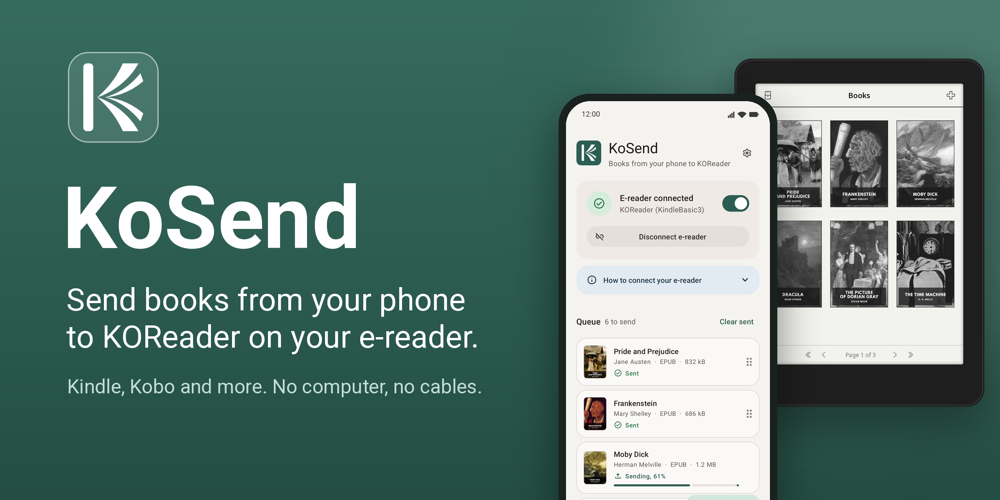
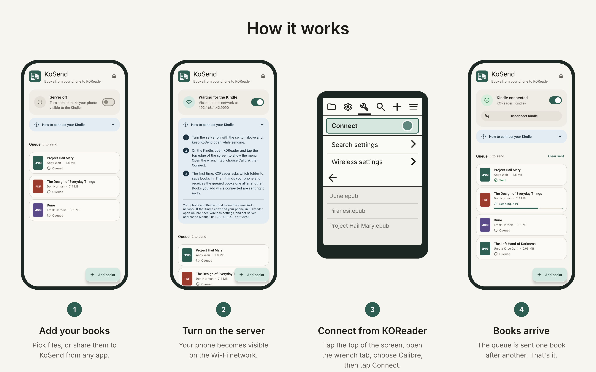
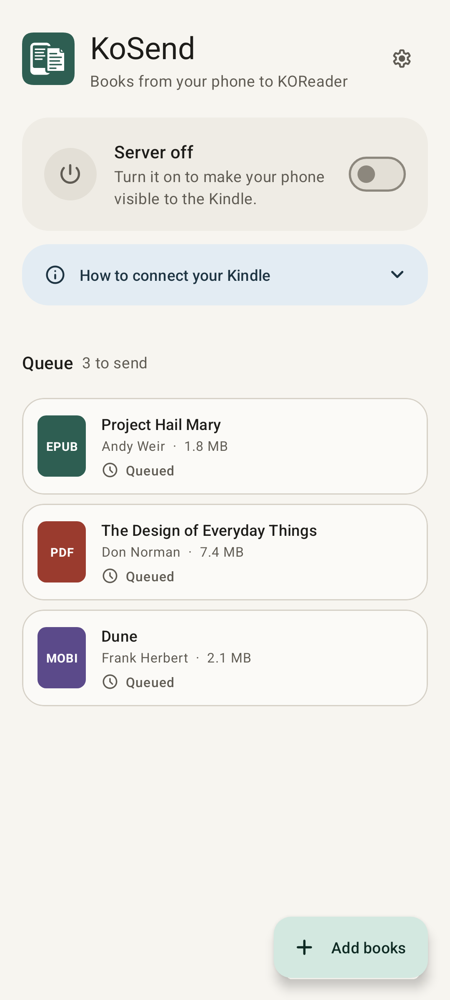
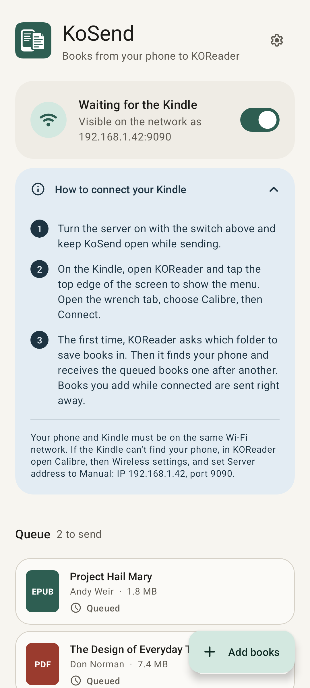
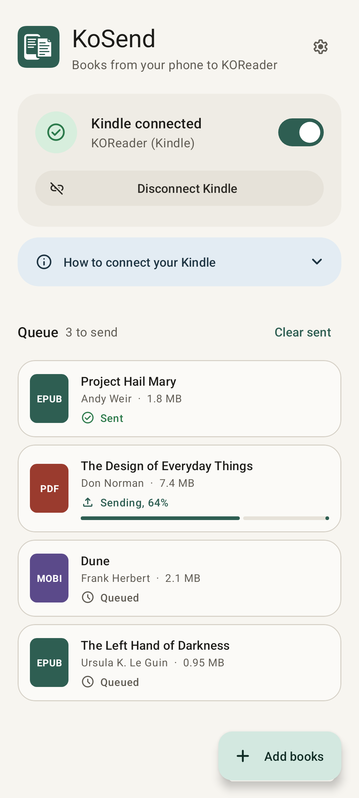
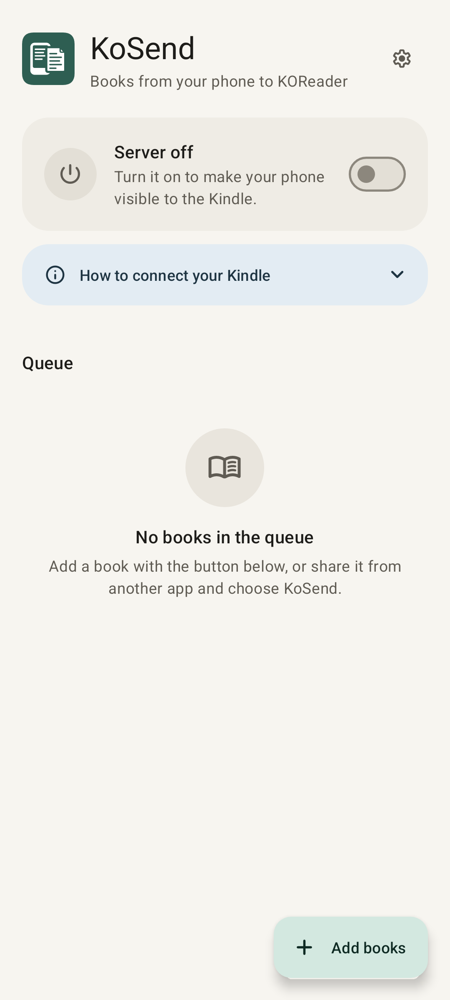
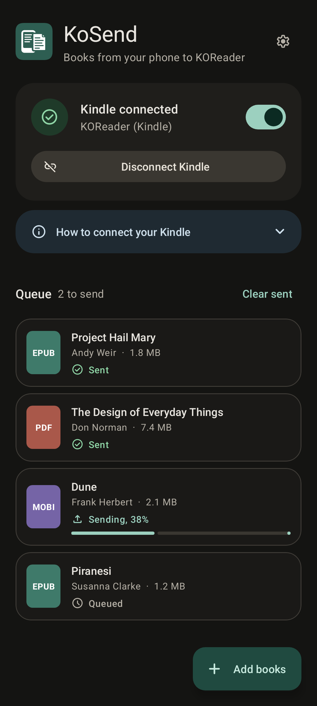
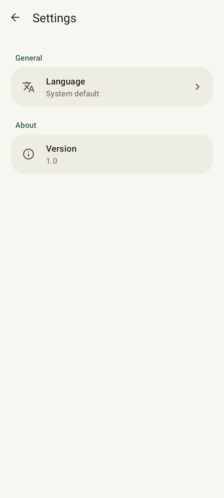

<p align="center">
  
</p>

# KoSend

**Your phone is now the fastest way to put a book on your Kindle.**

KoSend is a small Android app that sends EPUB, PDF and MOBI files straight to
[KOReader](https://koreader.rocks) on a jailbroken Kindle, over Wi-Fi.
No computer to turn on, no USB cable, no calibre library to maintain:
queue the books on your phone, tap **Connect** on the Kindle, and they arrive.

It works with the wireless client KOReader already ships with, so there is
nothing to install on the Kindle.

## Features

- **One tap on the Kindle.** KOReader finds your phone on the network by itself.
- **A queue, not a chore.** Add books whenever you find them; they are sent the next time the Kindle connects.
- **Share from anywhere.** Browser downloads, file managers, Telegram, email: share a file and pick KoSend.
- **Real titles.** Title and author are read from the EPUB, so books show up properly in KOReader's calibre search.
- **Private by design.** Everything stays on your local network. No accounts, no cloud, no tracking.
- **Battery friendly.** The server only runs while KoSend is open and switched on.
- **Light and dark theme**, English and Italian.

## How it works

<p align="center">
  
</p>

1. **Add your books** with the button, or share them to KoSend from any app.
2. **Turn on the server** with the switch. Keep KoSend open.
3. **On the Kindle**, open KOReader and tap the top edge of the screen to show the menu.
   Open the **wrench** tab (Tools), choose **Calibre**, then tap **Connect**.
   The first time, KOReader asks which folder to save the books in.
4. **Done.** KOReader finds your phone on its own and the queue is sent one book after another.
   Books you add while the Kindle is connected go out right away.

To disconnect, open the same menu again: *Connect* has become *Disconnect*. You can also tap
*Disconnect Kindle* in KoSend.

## Screenshots

| Queue | Waiting for the Kindle | Sending |
|:---:|:---:|:---:|
|  |  |  |

| Empty queue | Dark theme | Settings |
|:---:|:---:|:---:|
|  |  |  |

## Requirements

- An Android phone running Android 8.0 or later.
- A Kindle with [KOReader](https://koreader.rocks) installed. The calibre plugin is included in KOReader.
- Phone and Kindle on the **same Wi-Fi network**.

## Install

Download the latest APK from the [Releases](../../releases) page and open it on your phone.
Android will ask you to allow installing apps from that source.

Or build it yourself, see [Building](#building).

Release APKs are signed with this certificate (SHA-256):

```
FD:FB:D8:E0:1C:8A:08:E5:F5:09:E3:7E:8F:5A:CA:CE:A4:D8:B1:C6:0E:09:9B:F0:E0:B3:D4:B3:A1:7A:B6:10
```

You can check it with `apksigner verify --print-certs KoSend.apk`.

## Troubleshooting

**The Kindle can't find the phone.**
Some networks block the broadcast KOReader uses to look for calibre: guest networks,
mesh systems and routers with "client isolation" or "AP isolation". You can skip the
search: in KOReader open the wrench tab, then *Calibre*, *Wireless settings*, and set
*Server address* to *Manual* with the IP and port KoSend shows on its main screen.

**A book shows "KOReader doesn't accept .azw3 files".**
KOReader can't open Kindle's KF8 format, so it refuses it. Convert the book to EPUB first.

**The transfer stops when I leave the app.**
That is on purpose: the server only runs while KoSend is in the foreground. Books
that didn't finish go back to the queue and are sent at the next connection.

## Under the hood

KOReader includes a client for calibre's *wireless device connection*. KoSend
implements the server side of that protocol, just the part KOReader needs:

1. **Discovery.** KOReader broadcasts `hello` over UDP to calibre's ports
   (54982, 48123, 39001, 44044, 59678). KoSend answers with the TCP port it listens on.
2. **Handshake.** Messages are JSON arrays prefixed by their length in bytes,
   `<length>[opcode, {payload}]`. KoSend sends `GET_INITIALIZATION_INFO`,
   `GET_DEVICE_INFORMATION`, `SET_CALIBRE_DEVICE_INFO`, `FREE_SPACE`,
   `SET_LIBRARY_INFO` and `GET_BOOK_COUNT`.
3. **Transfer.** For each book, `SEND_BOOK` with its name and metadata; KOReader
   replies `OK` (or `ERROR`), then the raw file follows. A `NOOP` afterwards
   confirms that KOReader has written everything.

**KoSend is not a calibre replacement.** It has no library, doesn't edit metadata,
doesn't convert formats and doesn't read books back from the Kindle. It does one
thing: deliver files from your phone to KOReader.

The reference is KOReader's own client,
[`plugins/calibre.koplugin/wireless.lua`](https://github.com/koreader/koreader/blob/master/plugins/calibre.koplugin/wireless.lua).

## Building

You need JDK 17 and the Android SDK (platform 35, build-tools 35).
Put the SDK path in `local.properties`:

```properties
sdk.dir=/home/you/android-sdk
```

Then:

```sh
./build.sh          # release APK in dist/
./build.sh debug    # debug APK, faster
```

Release builds are signed with the key described in `keystore.properties`
(not in the repository). Without it they fall back to the debug key:

```properties
storeFile=release.jks
storePassword=...
keyAlias=kosend
keyPassword=...
```

To regenerate the screenshots in this README:

```sh
./gradlew screenshots
```

They are rendered from the app's layouts on the JVM, with no device or emulator,
using [Paparazzi](https://github.com/cashapp/paparazzi). The screens and sample data
are defined in `app/src/test/java/dev/kosend/ReadmeScreenshots.kt`.

Project layout:

```
app/src/main/java/dev/kosend/
  CalibreServer.kt     the protocol: discovery, handshake, transfers
  ServerController.kt  starts and stops the server
  KoSendApp.kt         stops the server when the app goes to the background
  BookStore.kt         the queue, saved on the phone
  BookMeta.kt          title and author from EPUB files
  MainActivity.kt      main screen and file import
  QueueAdapter.kt      status card, help box and book list
  SettingsActivity.kt  language and version
design/                logo and README artwork (VectorCraft sources)
docs/                  images used by this README
```

## License

KoSend is free software, released under the [GNU General Public License v3.0](LICENSE).
You can use, study, share and modify it; modified versions you distribute must stay under the same license.

## Credits

Built on the work of the [KOReader](https://github.com/koreader/koreader) team and the
wireless device protocol designed by [calibre](https://calibre-ebook.com).
Icons from [Material Symbols](https://fonts.google.com/icons).

KoSend is an independent project, not affiliated with Amazon, calibre or KOReader.
Kindle is a trademark of Amazon.com, Inc.
